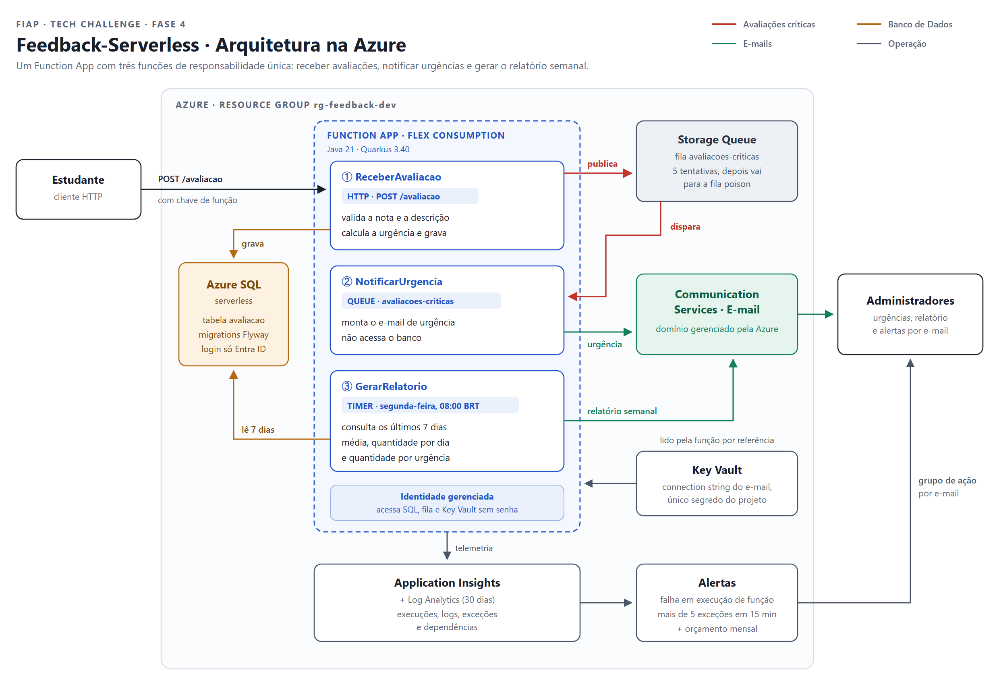

<div align="center"> <br>
  
</div>

<br>

<div align="center">
  Plataforma de feedback de aulas do Tech Challenge da Fase 4 da FIAP. Os estudantes avaliam as aulas, os administradores recebem um e-mail quando uma avaliação é crítica e, toda segunda-feira, um relatório da semana. Roda em funções serverless na Azure.
</div>

<br> <br>

## 🚀 Ferramentas Utilizadas

* 📨 Qute

* 🔷 Bicep

* 🐳 Docker

* 🕊️ Flyway

* 🔴 Lombok

* 🧱 Azurite

* ☕️ Java 21

* 🧪 JUnit 5

* 🗺️ MapStruct

* 🐘 Gradle 9.8.0

* ⚡ Quarkus 3.40.1

* ⚙️ GitHub Actions

* 🔐 Azure Key Vault

* ☁️ Azure Functions

* 🗄️ SQL Server 2022

* 📬 Azure Storage Queue

* 📈 Application Insights

* 🛢️ Azure SQL Database (serverless)

* ✉️ Azure Communication Services (Email)

<br>

## 🔎 Como Funciona

Um Function App com três funções, cada uma com um gatilho:

| Função | Gatilho | O que faz |
|---|---|---|
| ⚡ **ReceberAvaliacao** | HTTP `POST /avaliacao` | Valida, calcula a urgência, grava no banco e publica na fila quando a avaliação é crítica |
| 📬 **NotificarUrgencia** | Fila `avaliacoes-criticas` | Envia aos administradores o e-mail com descrição, urgência e data de envio |
| 📊 **GerarRelatorio** | Timer `0 0 11 * * 1` (segunda, 08:00 de Brasília) | Envia a média das notas e a quantidade por dia e por urgência dos últimos 7 dias |



A urgência sai da nota, em `Urgencia.deNota`:

| Nota | Urgência | Efeito |
|---|---|---|
| 0 a 3 | Crítica | E-mail imediato pela fila |
| 4 a 6 | Média | Só no relatório |
| 7 a 10 | Baixa | Só no relatório |

Se o envio do e-mail falhar, a fila tenta de novo até 5 vezes e depois move a mensagem para `avaliacoes-criticas-poison`.

<br>

## 🧭 Modelo de Cloud

Nuvem pública (Azure), com as funções em FaaS e o restante em serviços gerenciados (PaaS):

| Componente | Serviço | Modelo |
|---|---|---|
| Funções | Azure Functions, plano Flex Consumption | FaaS |
| Banco de dados | Azure SQL Database serverless, com oferta gratuita | PaaS |
| Fila | Azure Storage Queue | PaaS |
| E-mail | Azure Communication Services | PaaS |
| Segredo | Azure Key Vault | PaaS |
| Monitoramento | Application Insights e Log Analytics | PaaS |

Funções e banco escalam até zero: o custo acompanha o uso, o que cabe nos créditos da conta Azure for Students.

<br>

## 🧩 Decisões de Arquitetura

| Decisão | Motivo |
|---|---|
| Azure, com a conta Azure for Students | Indicação dos professores: dá créditos sem cartão de crédito |
| Tudo em Java (Quarkus) | Pedido dos professores. Bicep e YAML ficam só na infraestrutura e no pipeline |
| Azure Communication Services em vez de SendGrid | O SendGrid não tem plano gratuito para contas novas do Azure for Students. Os professores confirmaram que o ACS atende |
| `GerarRelatorio` lê o banco direto | Não há uma aplicação principal para chamar. Os professores confirmaram que a função pode acessar o banco |
| Chave de função no `POST /avaliacao`, sem login | A avaliação é anônima e os administradores só recebem e-mails. Os professores aceitam serviço gerenciado ou Java para autenticação; se for preciso identificar o estudante, o caminho é a autenticação do App Service com Entra ID |
| Fila entre a entrada e a notificação | O estudante recebe a resposta na hora e uma falha no e-mail não perde a notificação |

<br>

## 🔌 API

### `POST /avaliacao`

Exige a chave da função, em `?code=<chave>` ou no cabeçalho `x-functions-key`.

```json
{
  "nota": 2,
  "descricao": "O áudio cortou várias vezes durante a aula"
}
```

| Status | Quando |
|---|---|
| `201 Created` | Avaliação gravada; o corpo traz `id`, `nota`, `descricao`, `urgencia` e `dataEnvio` |
| `400 Bad Request` | JSON inválido, nota ausente ou fora de 0 a 10, descrição vazia ou com mais de 500 caracteres |
| `401 Unauthorized` | Chave ausente ou inválida |
| `500 Internal Server Error` | Falha inesperada |

Os erros seguem o formato `status`, `title`, `instance`, `type`, `detail`, `errors` e `timestamp`, montado pelo `FunctionExceptionHandler`.

<br>

## 📮 Postman

A pasta `postman` tem a collection com todos os endpoints do ambiente publicado e o environment `Feedback-Serverless · Azure`. Importe os dois arquivos no Postman e selecione o environment.

| Requisição | Endpoint | O que faz |
|---|---|---|
| Status do host | `GET /admin/host/status` | Mostra se o runtime está rodando |
| Listar as funções | `GET /admin/functions` | Lista as três funções e os gatilhos |
| Receber avaliação | `POST /avaliacao` | Grava uma avaliação crítica, que também dispara o e-mail de urgência |
| Executar a notificação de urgência | `POST /admin/functions/NotificarUrgencia` | Envia o e-mail de urgência na hora, com a mensagem que a fila entregaria |
| Gerar o relatório semanal | `POST /admin/functions/GerarRelatorio` | Envia o relatório dos 7 dias anteriores na hora |

<br>

## ⚙️ Pré-requisitos

* JDK 21 instalada

* Docker, para o SQL Server e o Azurite

* Azure Functions Core Tools 4, para rodar as funções localmente

* Azure CLI e uma assinatura Azure, para publicar

<br>

## 🔐 Variáveis de Ambiente

Criadas pelo Bicep como configurações do Function App:

| Variável | Descrição |
|---|---|
| `AzureWebJobsStorage__accountName` | Conta de storage do runtime e da fila, acessada por identidade gerenciada |
| `APPLICATIONINSIGHTS_CONNECTION_STRING` | Destino dos logs e métricas |
| `DATABASE_URL` | JDBC do Azure SQL com `authentication=ActiveDirectoryMSI` |
| `FILA_ENDPOINT` | Endpoint da Storage Queue |
| `EMAIL_CONNECTION_STRING` | Referência ao segredo do Key Vault com a connection string do Communication Services |
| `EMAIL_REMETENTE` | Remetente do domínio gerenciado pela Azure |
| `EMAIL_DESTINATARIOS` | E-mails dos administradores, separados por vírgula |

Nos perfis `dev` e `test`, o banco e a fila apontam para o `docker-compose.yml` e o e-mail só é registrado no log.

<br>

## ▶️ Como Executar

```bash
# Sobe o SQL Server (porta 1433) e o Azurite (portas 10000 a 10002)
docker compose up -d --wait

# Copia as configurações locais do runtime (perfil dev)
cp local.settings.example.json local.settings.json

# Gera o pacote e sobe as três funções em http://localhost:8081
./gradlew quarkusRun
```

No IntelliJ, os perfis de `.run/` fazem o mesmo: `QuarkusRun - DEV`, `QuarkusRun - PROD`, `Clean Build - [Without Tests]` e `Testes de Integração`.

<br>

## 🧪 Testes e Build

```bash
# Testes de integração contra o SQL Server e o Azurite do docker-compose
./gradlew test

# Testes e pacote em build/azure-functions/<function-app>
./gradlew build
```

Os testes usam o banco `feedback_test`, populado por `db/test/V2__PopularBanco.sql`, e a fila `avaliacoes-criticas-teste`.

<br>

## ☁️ Deploy na Azure

🔹 1. Infraestrutura

```bash
# Registra os provedores usados (uma vez por assinatura)
for p in Microsoft.Web Microsoft.Sql Microsoft.Storage Microsoft.Communication Microsoft.KeyVault Microsoft.Insights Microsoft.OperationalInsights Microsoft.AlertsManagement Microsoft.ManagedIdentity; do az provider register -n $p --wait; done

# Cria o resource group
az group create --name rg-feedback-dev --location francecentral

# Cria Function App, banco, fila, e-mail, Key Vault, monitoramento, permissões e orçamento
az deployment group create --name feedback-dev --resource-group rg-feedback-dev --template-file infra/main.bicep --parameters location=francecentral emailsAdministradores='["admin@exemplo.com"]' adminSqlLogin=<login> adminSqlObjectId=<id> adminSqlTipo=User
```

A conta Azure for Students só libera algumas regiões. Das liberadas para o grupo, `francecentral` é a que tem Flex Consumption e aceita Azure SQL.

🔹 2. Acesso da função ao banco

Rode no banco `feedback`, como administrador Entra ID (Query editor do portal ou `sqlcmd --authentication-method ActiveDirectoryAzCli`):

```sql
CREATE USER [func-feedback-dev-xxxxxx] FROM EXTERNAL PROVIDER;
ALTER ROLE db_datareader ADD MEMBER [func-feedback-dev-xxxxxx];
ALTER ROLE db_datawriter ADD MEMBER [func-feedback-dev-xxxxxx];
ALTER ROLE db_ddladmin ADD MEMBER [func-feedback-dev-xxxxxx];
```

🔹 3. Deploy automático

```bash
# Identidade usada pelo GitHub Actions
az identity create --resource-group rg-feedback-dev --name id-github-feedback --query "{clientId:clientId, principalId:principalId}"

# Confia nos tokens do GitHub para o environment dev
az identity federated-credential create --resource-group rg-feedback-dev --identity-name id-github-feedback --name github-dev --issuer https://token.actions.githubusercontent.com --subject "repo:JavaPosTech@<owner-id>/Feedback-Serverless@<repo-id>:environment:dev" --audiences api://AzureADTokenExchange

# Secrets do environment dev no GitHub, mascarados nos logs
gh secret set AZURE_CLIENT_ID --env dev --body <clientId>
gh secret set AZURE_TENANT_ID --env dev --body "$(az account show --query tenantId -o tsv)"
gh secret set AZURE_SUBSCRIPTION_ID --env dev --body "$(az account show --query id -o tsv)"

# Nome do Function App, que define a pasta do pacote
gh variable set FUNCTION_APP_NAME --env dev --body <function-app>
```

Depois, rode o `az deployment group create` de novo com `implantadorPrincipalId=<principalId>` para dar à identidade o papel de colaborador do Function App. O `<owner-id>` e o `<repo-id>` saem de `gh api repos/JavaPosTech/Feedback-Serverless --jq '"\(.owner.id) \(.id)"'`.

🔹 4. Testar

```bash
# Chave da função de entrada
az functionapp function keys list --resource-group rg-feedback-dev --name <function-app> --function-name ReceberAvaliacao

# Avaliação crítica, que dispara o e-mail de urgência
curl -X POST "https://<function-app>.azurewebsites.net/avaliacao?code=<chave>" -H "Content-Type: application/json" -d '{"nota":1,"descricao":"O vídeo não carrega"}'

# Relatório na hora, com a master key de az functionapp keys list
curl -X POST "https://<function-app>.azurewebsites.net/admin/functions/GerarRelatorio" -H "x-functions-key: <master-key>" -H "Content-Type: application/json" -d '{}'
```

<br>

## 🤖 Integração Contínua

| Workflow | Gatilho | O que faz |
|---|---|---|
| `ci.yml` | Pull Request para `main` | Sobe SQL Server e Azurite e roda `./gradlew build` |
| `deploy.yml` | Push na `main` ou execução manual | Roda os testes, entra na Azure por OIDC e publica as três funções |

<br>

## 📈 Monitoramento

O Application Insights recebe logs, métricas e a execução de cada função. Dois alertas avisam os administradores por e-mail:

| Alerta | Condição | Severidade |
|---|---|---|
| Execuções de função com falha | Alguma execução com erro nos últimos 5 minutos | 1 |
| Exceções na aplicação | Mais de 5 exceções em 15 minutos | 2 |

<br>

## 🛡️ Segurança e Governança

* **Dados anônimos:** a avaliação guarda só nota, descrição, urgência e data de envio.

* **Sem senhas:** a função acessa banco, fila e Key Vault com identidade gerenciada, e o SQL Server só aceita login Entra ID.

* **Único segredo:** a connection string do Communication Services fica no Key Vault.

* **Menor privilégio:** cada identidade recebe só os papéis de que precisa.

* **Transporte:** HTTPS obrigatório, TLS 1.2, FTP desligado e storage sem acesso público nem chave compartilhada.

* **Criptografia em repouso:** TDE no Azure SQL e criptografia padrão no storage.

* **Custo:** tags em todos os recursos e orçamento mensal com aviso em 80% do gasto e 100% da previsão.

<br>

## 📁 Estrutura

```
src/main/java/br/com/fiap/feedback
├── function                    # Uma classe por gatilho
├── service                     # Regras de negócio
├── repository                  # Repositório Panache e consultas do relatório
├── client                      # Fila e e-mail da Azure
├── template                    # Templates Qute dos e-mails
├── model                       # dto, entity e mapper
├── enums                       # Urgencia e a regra da nota
├── exceptions                  # Exceções, dto e FunctionExceptionHandler
└── config                      # FeedbackConfig e clientes do SDK da Azure

src/main/resources
├── application.properties      # Configuração por perfil
├── db/migration                # Migrations do Flyway
└── templates/email             # HTML dos e-mails

infra
├── main.bicep                  # Módulos, orçamento e saídas
├── dev.bicepparam              # Parâmetros do ambiente dev
└── modules                     # function-app, sql, storage, email, keyvault, monitoring e rbac

postman
├── Feedback-Serverless.postman_collection.json            # Todos os endpoints
└── Feedback-Serverless-Azure.postman_environment.json     # Ambiente publicado
```

<br>

## ⚠️ Limitações

* O Azure SQL pausa após 60 minutos sem uso. A primeira chamada depois disso leva de 30 segundos a 1 minuto, enquanto o Flyway tenta conectar de novo (`quarkus.flyway.connect-retries` no perfil `prod`); as seguintes respondem em menos de 1 segundo.

* O `functionTimeout` é de 5 minutos e o `GerarRelatorio` tenta de novo até 3 vezes se falhar, porque um timer não é reexecutado sozinho.

* Se a publicação na fila falhar depois de gravar a avaliação, a função responde 500 e a avaliação fica salva sem notificação.

* O relatório lista todas as avaliações da semana no corpo do e-mail; com muito volume, um anexo seria melhor.