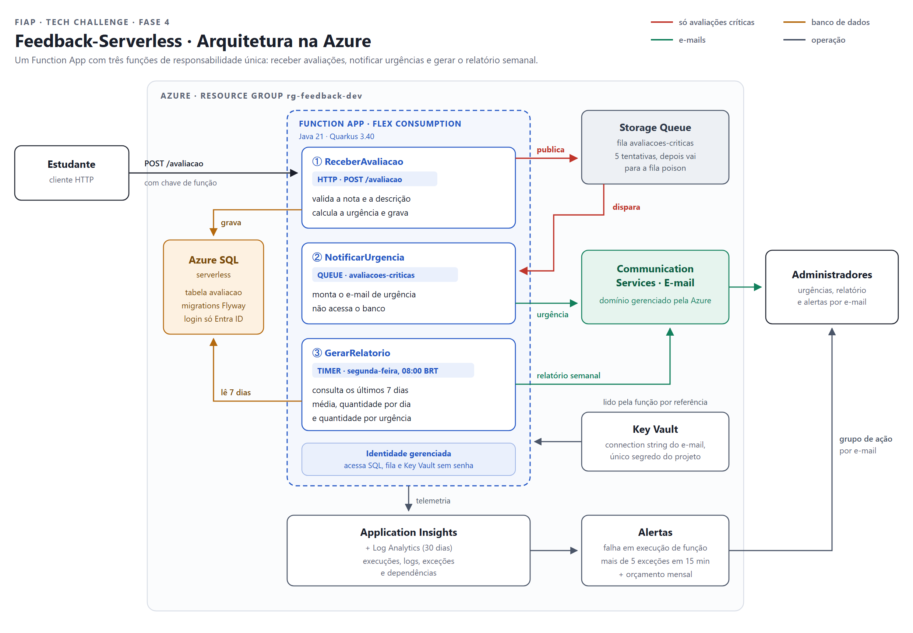

<div align="center"> <br>
  
</div>

<br>

<div align="center">
  Plataforma de feedback de aulas construída com funções serverless na Azure. Os estudantes avaliam as aulas, os administradores recebem um e-mail quando uma avaliação é crítica e, toda semana, um relatório com a média e a distribuição das avaliações. Projeto do Tech Challenge da Fase 4 da FIAP.
</div>

<br> <br>

## 🚀 Ferramentas Utilizadas

* 📨 Qute

* 🔷 Bicep

* 🐳 Docker

* 🕊️ Flyway

* 🔴 Lombok

* 🧱 Azurite

* ☕️ Java 21

* 🧪 JUnit 5

* 🗺️ MapStruct

* 🐘 Gradle 9.8.0

* ⚡ Quarkus 3.40.1

* ⚙️ GitHub Actions

* 🔐 Azure Key Vault

* ☁️ Azure Functions

* 🗄️ SQL Server 2022

* 📬 Azure Storage Queue

* 📈 Application Insights

* 🛢️ Azure SQL Database (serverless)

* ✉️ Azure Communication Services (Email)

<br>

## 🎯 Objetivo

Receber avaliações de aulas, avisar os administradores sobre problemas críticos assim que eles acontecem e entregar um relatório semanal para acompanhar a satisfação dos estudantes, sem manter nenhum servidor ligado. A solução roda inteira no modelo serverless: cada função só executa quando o seu gatilho acontece e o banco pausa sozinho quando ninguém usa.

<br>

## 🔎 Como Funciona

O projeto é **um repositório e um Function App com três funções**. Cada função tem um gatilho e uma única responsabilidade:

| Função | Gatilho | Responsabilidade |
|---|---|---|
| ⚡ **ReceberAvaliacao** | HTTP `POST /avaliacao` | Valida, calcula a urgência, grava no banco e, se a avaliação for crítica, publica na fila |
| 📬 **NotificarUrgencia** | Mensagem na fila `avaliacoes-criticas` | Envia aos administradores o e-mail com descrição, urgência e data de envio |
| 📊 **GerarRelatorio** | Timer `0 0 11 * * 1` (segunda, 08:00 de Brasília) | Calcula média, quantidade por dia e por urgência dos últimos 7 dias e envia o relatório |



* **Por que uma fila entre a entrada e a notificação:** o estudante recebe a resposta na hora, uma falha no envio do e-mail não perde a avaliação e a fila tenta de novo sozinha (5 tentativas, depois a mensagem vai para `avaliacoes-criticas-poison`).

* **Regra de urgência:** fica em `Urgencia.deNota` e é a única regra que decide o fluxo.

| Nota | Urgência | Efeito |
|---|---|---|
| 0 a 3 | Crítica | E-mail imediato via fila |
| 4 a 6 | Média | Entra só no relatório |
| 7 a 10 | Baixa | Entra só no relatório |

<br>

## 🧭 Modelo de Cloud

A solução roda em **nuvem pública (Microsoft Azure)** no modelo **serverless**: o código de negócio vive em funções (**FaaS**) e tudo o que dá suporte a elas é serviço gerenciado (**PaaS**). Não existe máquina virtual, sistema operacional ou servidor para manter.

| Componente | Serviço Azure | Modelo | Por que este serviço |
|---|---|---|---|
| Funções | Azure Functions, plano **Flex Consumption** | FaaS | Cobra por execução, escala até zero quando ninguém usa e escala sozinho sob carga |
| Banco de dados | Azure SQL Database **serverless** | PaaS | Oferta gratuita mensal (`useFreeLimit`), pausa após 60 minutos sem uso e, se a cota gratuita acabar, pausa em vez de cobrar |
| Fila | Azure Storage Queue | PaaS | Desacopla a entrada da notificação, com novas tentativas e fila poison nativas |
| E-mail | Azure Communication Services (Email) | PaaS | Envio transacional com domínio gerenciado pela Azure, sem configurar domínio próprio |
| Segredo | Azure Key Vault | PaaS | Guarda a connection string do e-mail fora do código e da configuração |
| Monitoramento | Application Insights e Log Analytics | PaaS | Logs, métricas, execução de cada função e alertas |
| Infraestrutura | Bicep | IaC | Toda a infraestrutura é declarada no repositório e recriada com um comando |

* **Por que serverless:** as três cargas de trabalho são esporádicas (uma requisição por avaliação, uma mensagem por avaliação crítica e uma execução por semana). Um servidor ligado o tempo todo pagaria pela ociosidade.

* **Por que três funções:** cada uma tem um gatilho e uma responsabilidade, como pede a regra de Responsabilidade Única do desafio. Elas ficam no mesmo Function App porque compartilham o modelo de dados, a configuração e o pipeline de deploy, mas escalam e falham de forma independente.

* **Por que Azure:** a conta [Azure for Students](https://azure.microsoft.com/pt-br/free/students) dá créditos sem exigir cartão de crédito, e a solução foi dimensionada para caber nesses créditos.

<br>

## 🧩 Decisões de Arquitetura

| Decisão | Alternativa descartada | Motivo |
|---|---|---|
| Azure, com a conta Azure for Students | AWS ou Google Cloud | Indicação dos professores: é a única com créditos para estudante sem cartão de crédito |
| Toda a aplicação em Java (Quarkus) | Funções em outras linguagens | Requisito confirmado pelos professores. Bicep e YAML aparecem apenas na infraestrutura e no pipeline |
| Azure Communication Services para os e-mails | SendGrid | O SendGrid não tem mais plano gratuito para contas novas do Azure for Students. Os professores confirmaram que o ACS atende ao requisito de notificações automáticas |
| `GerarRelatorio` consulta o banco direto | Chamar uma API da aplicação | Não existe uma aplicação principal separada. Os professores confirmaram que a função pode acessar o banco |
| Chave de função no `POST /avaliacao`, com RBAC e identidade gerenciada na infraestrutura | Login do estudante (Entra ID ou JWT próprio) | O desafio não pede identificação do estudante e a avaliação é anônima. Os administradores não têm endpoint, só recebem e-mails. Os professores aceitam tanto um serviço gerenciado da nuvem quanto a implementação em Java; se for preciso identificar o estudante, o caminho é a autenticação nativa do App Service com Entra ID |
| Fila entre a entrada e a notificação | Enviar o e-mail dentro da requisição | O estudante não espera o e-mail sair, e uma falha no envio não perde a notificação |

<br>

## 🔌 API

### `POST /avaliacao`

Protegido por chave de função: envie `?code=<chave>` ou o cabeçalho `x-functions-key`.

```json
{
  "nota": 2,
  "descricao": "O áudio cortou várias vezes durante a aula"
}
```

| Status | Quando |
|---|---|
| `201 Created` | Avaliação gravada. O corpo traz `id`, `nota`, `descricao`, `urgencia` e `dataEnvio` |
| `400 Bad Request` | JSON inválido, nota ausente ou fora de 0 a 10, descrição vazia ou acima de 500 caracteres |
| `500 Internal Server Error` | Falha inesperada, registrada no Application Insights |

Os erros seguem um único formato (`status`, `title`, `instance`, `type`, `detail`, `errors`, `timestamp`), montado por `FunctionExceptionHandler`.

<br>

## ⚙️ Pré-requisitos

* JDK 21 instalada (o Gradle Wrapper baixa o Gradle sozinho)

* Docker, para subir o SQL Server e o Azurite usados nos testes

* Azure CLI e uma assinatura Azure, apenas para publicar

* Azure Functions Core Tools 4 (`npm install -g azure-functions-core-tools@4`), para rodar as funções localmente e publicar na Azure

<br>

## 🔐 Variáveis de Ambiente

Em produção, todas são criadas pelo Bicep como configurações do Function App:

| Variável | Descrição |
|---|---|
| `AzureWebJobsStorage__accountName` | Conta de storage usada pelo runtime e pela fila, acessada por identidade gerenciada |
| `APPLICATIONINSIGHTS_CONNECTION_STRING` | Destino dos logs, métricas e traces |
| `DATABASE_URL` | JDBC do Azure SQL com `authentication=ActiveDirectoryMSI` (sem senha) |
| `FILA_ENDPOINT` | Endpoint da Storage Queue, acessado por identidade gerenciada |
| `EMAIL_CONNECTION_STRING` | Referência ao segredo do Key Vault com a connection string do Communication Services |
| `EMAIL_REMETENTE` | Remetente do domínio gerenciado pela Azure |
| `EMAIL_DESTINATARIOS` | E-mails dos administradores, separados por vírgula |

Nos perfis `dev` e `test`, o banco aponta para o SQL Server do `docker-compose.yml`, a fila para o Azurite e o envio de e-mail é simulado no log. A senha local pode ser trocada criando um `.env` a partir do `.env.example`.

<br>

## ▶️ Como Executar

🔹 Serviços locais

```bash
# Sobe o SQL Server (porta 1433, cria os bancos feedback e feedback_test) e o Azurite (portas 10000 a 10002)
docker compose up -d --wait
```

🔹 Perfis do IntelliJ

A pasta `.run` traz os perfis prontos, que aparecem no seletor de execução do IntelliJ:

| Perfil | Comando | O que faz |
|---|---|---|
| 🟢 **QuarkusRun - DEV** | `quarkusRun` | Gera o pacote e sobe as três funções com o perfil `dev`: banco `feedback` local, fila no Azurite e e-mail simulado no log |
| 🔴 **QuarkusRun - PROD** | `quarkusRun` | Sobe as funções com o perfil `prod`, a mesma configuração da Azure, apontando para o SQL Server e o Azurite locais e com o e-mail simulado |
| 🧱 **Clean Build - [Without Tests]** | `clean build -x test` | Gera o pacote em `build/azure-functions` sem rodar os testes |
| 🧪 **Testes de Integração** | `:test` | Roda os testes contra o banco `feedback_test` e a fila `avaliacoes-criticas-teste` |

🔹 Funções pelo terminal

```bash
# Copia as configurações locais do runtime de Functions (perfil dev)
cp local.settings.example.json local.settings.json

# Gera o pacote e inicia as três funções com o Azure Functions Core Tools
./gradlew quarkusRun
```

Com as funções rodando, a avaliação é enviada para `http://localhost:8081/avaliacao`. As variáveis definidas no ambiente têm prioridade sobre o `local.settings.json`, e é assim que os perfis do IntelliJ escolhem entre `dev` e `prod`.

<br>

## 🧪 Testes e Build

```bash
# Testes de integração contra o SQL Server e o Azurite do docker-compose
./gradlew test

# Roda os testes e gera o pacote para a Azure em build/azure-functions/<nome-do-function-app>
./gradlew build
```

Cada teste sobe o contexto completo do Quarkus, roda contra o banco `feedback_test` populado por `db/test/V2__PopularBanco.sql` e desfaz as alterações ao final com `@TestTransaction`. Os testes usam banco e fila próprios para não misturar dados com o perfil `dev`.

<br>

## ☁️ Deploy na Azure

🔹 1. Criar a infraestrutura

```bash
# Cria o resource group
az group create --name rg-feedback-dev --location brazilsouth

# Cria Function App, banco, fila, e-mail, Key Vault, monitoramento, permissões e orçamento
az deployment group create --resource-group rg-feedback-dev --template-file infra/main.bicep --parameters infra/dev.bicepparam
```

Antes, preencha `infra/dev.bicepparam` com os e-mails dos administradores e o administrador Entra ID do SQL (`az ad signed-in-user show --query "{login:userPrincipalName, id:id}"`).

Na conta Azure for Students:

* **Região:** a assinatura só aceita algumas regiões. Confira quais estão liberadas em Policy → Assignments no portal e se a região oferece Flex Consumption (`az functionapp list-flexconsumption-locations`).

* **Orçamento:** se o deploy falhar no recurso `orcamento`, a oferta não aceita budgets. Use `param orcamentoMensal = 0` para não criá-lo.

🔹 2. Dar acesso da função ao banco

No Query editor do banco `feedback`, entrando com o administrador Entra ID, troque o nome pelo do Function App criado:

```sql
CREATE USER [func-feedback-dev-xxxxxx] FROM EXTERNAL PROVIDER;
ALTER ROLE db_datareader ADD MEMBER [func-feedback-dev-xxxxxx];
ALTER ROLE db_datawriter ADD MEMBER [func-feedback-dev-xxxxxx];
ALTER ROLE db_ddladmin ADD MEMBER [func-feedback-dev-xxxxxx];
```

🔹 3. Publicar e testar

```bash
# Gera o pacote em build/azure-functions/<function-app>
FUNCTION_APP_NAME=<function-app> ./gradlew build

# Publica as três funções com o Azure Functions Core Tools
cd build/azure-functions/<function-app> && func azure functionapp publish <function-app>

# Busca a chave da função de entrada
az functionapp function keys list --resource-group rg-feedback-dev --name <function-app> --function-name ReceberAvaliacao

# Envia uma avaliação crítica, que dispara o e-mail de urgência
curl -X POST "https://<function-app>.azurewebsites.net/avaliacao?code=<chave>" -H "Content-Type: application/json" -d '{"nota":1,"descricao":"O vídeo não carrega"}'

# Dispara o relatório semanal na hora, sem esperar a segunda-feira
curl -X POST "https://<function-app>.azurewebsites.net/admin/functions/GerarRelatorio" -H "x-functions-key: <master-key>" -H "Content-Type: application/json" -d '{}'
```

A `master-key` sai de `az functionapp keys list`.

🔹 4. Configurar o deploy automático

O GitHub Actions entra na Azure com uma identidade gerenciada e uma credencial federada (OIDC). Essa identidade não exige App Registration nem guarda segredo, e só tem permissão de publicar no Function App.

```bash
# Cria a identidade usada pelo GitHub Actions e mostra os IDs
az identity create --resource-group rg-feedback-dev --name id-github-feedback --query "{clientId:clientId, principalId:principalId}"

# Confia nos tokens emitidos pelo GitHub para o environment dev deste repositório
az identity federated-credential create --resource-group rg-feedback-dev --identity-name id-github-feedback --name github-dev --issuer https://token.actions.githubusercontent.com --subject repo:JavaPosTech/Feedback-Serverless:environment:dev --audiences api://AzureADTokenExchange
```

Coloque o `principalId` em `implantadorPrincipalId` no `infra/dev.bicepparam` e rode de novo o `az deployment group create` do passo 1, que dá à identidade o papel de colaborador do Function App. Depois, crie o environment e as variáveis no GitHub:

```bash
gh api --method PUT repos/JavaPosTech/Feedback-Serverless/environments/dev

gh variable set AZURE_CLIENT_ID --env dev --body <clientId>
gh variable set AZURE_TENANT_ID --env dev --body "$(az account show --query tenantId -o tsv)"
gh variable set AZURE_SUBSCRIPTION_ID --env dev --body "$(az account show --query id -o tsv)"
gh variable set FUNCTION_APP_NAME --env dev --body <function-app>
```

A partir daí, cada push na `main` testa e publica as funções. Para publicar sem push, use Actions → Deploy → Run workflow.

<br>

## 📈 Monitoramento

O Application Insights recebe logs, métricas e a execução de cada função. Dois alertas avisam os administradores por e-mail:

| Alerta | Condição | Severidade |
|---|---|---|
| Execuções de função com falha | Alguma execução terminou com erro nos últimos 5 minutos | 1 |
| Exceções na aplicação | Mais de 5 exceções em 15 minutos | 2 |

<br>

## 🛡️ Segurança e Governança

* **Dados anônimos:** a avaliação guarda só nota, descrição, urgência e data de envio. Nenhum dado pessoal do estudante é coletado, e os e-mails dos administradores ficam apenas na configuração do Function App.

* **Criptografia em repouso:** o Azure SQL usa Transparent Data Encryption, ativa por padrão, e a conta de storage criptografa a fila e os blobs.

* **Banco só com Entra ID:** o SQL Server aceita apenas autenticação Entra ID (`azureADOnlyAuthentication`), sem login nem senha SQL. A função acessa o banco com identidade gerenciada e permissões de leitura, escrita e DDL, esta última necessária para as migrations do Flyway.

* **Retenção limitada:** os logs ficam 30 dias no Log Analytics.

* **Sem senhas no código:** a função acessa banco, fila e Key Vault com identidade gerenciada.

* **Único segredo no Key Vault:** a connection string do Communication Services, lida pela função por referência.

* **Menor privilégio:** cada identidade recebe só os papéis de que precisa, e os membros do grupo entram como leitores.

* **Transporte protegido:** HTTPS obrigatório, TLS 1.2 mínimo, FTP e publicação por senha desativados, storage sem acesso público e sem chave compartilhada.

* **Governança de custo:** tags em todos os recursos e orçamento mensal com aviso em 80% do gasto real e 100% da previsão.

<br>

## 🤖 Integração Contínua

| Workflow | Gatilho | O que faz |
|---|---|---|
| `ci.yml` | Pull Request para `main` | Sobe SQL Server e Azurite e roda `./gradlew build` |
| `deploy.yml` | Push na `main` ou execução manual | Roda os testes, gera o pacote, entra na Azure por OIDC e publica as três funções no Function App |

O `deploy.yml` não usa senha nem segredo do GitHub: a Azure confia no token que o GitHub emite para o environment `dev`. A configuração está no passo 4 de "Deploy na Azure".

<br>

## 📁 Estrutura

```
src/main/java/br/com/fiap/feedback
├── function                    # As três funções: um gatilho por classe
├── service                     # Regras de negócio: avaliação, notificação e relatório
├── repository                  # Repositório Panache e consultas do relatório
├── client                      # Integrações com a fila e o e-mail da Azure
├── template                    # Templates Qute dos e-mails e formatação
├── model                       # dto, entity e mapper (MapStruct)
├── enums                       # Urgencia e a regra de classificação pela nota
├── exceptions                  # Exceções, dto e FunctionExceptionHandler
└── config                      # FeedbackConfig e clientes do SDK da Azure

src/main/resources
├── application.properties      # Configuração por perfil (dev, test e produção)
├── db/migration                # Migrations do Flyway
└── templates/email             # HTML dos e-mails de urgência e do relatório

infra
├── main.bicep                  # Orquestra os módulos, o orçamento e as saídas
├── dev.bicepparam              # Parâmetros do ambiente dev
└── modules                     # function-app, sql, storage, email, keyvault, monitoring e rbac

src/test/java/br/com/fiap/feedback
├── config                      # Classes base e dublês de requisição HTTP
├── function                    # Um teste por função
├── service                     # Um teste por método público de service
├── repository                  # Um teste por consulta do repositório
└── enums                       # Limites da regra de urgência
```

<br>

## ⚠️ Limitações

* A infraestrutura foi validada com `bicep build`, mas não foi publicada numa assinatura a partir deste repositório. Confira se a região escolhida oferece o plano Flex Consumption.

* Se a publicação na fila falhar depois de gravar a avaliação, a função responde 500 e a avaliação fica salva sem notificação. Um reenvio do cliente gera uma segunda avaliação.

* O relatório lista todas as avaliações da semana no corpo do e-mail. Para volumes grandes, o ideal seria um anexo ou um link.

* As datas são gravadas no horário de Brasília (`feedback.fuso-horario`), para que o relatório agrupe pelos dias que os administradores enxergam.